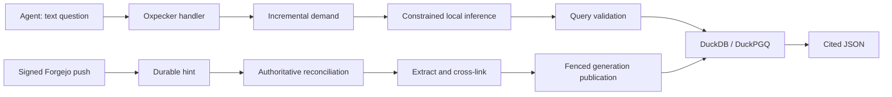

# fanion

1. cloth worn on priest's arm and used for handling holy vessels
1. small flag used in surveying

Ask a short question about a changing codebase. Get bounded graph results and
the source passages that support them, tied to exact commits and line spans.

Fanion is the retrieval service described in
[Retrieving Fidelity](https://clef-lang.com/blog/retrieving-fidelity/).
A small local model turns the question into a constrained query. The service
validates it, runs it against DuckDB/DuckPGQ, and returns JSON. Agents make one
request; discovery, query generation and evidence hydration stay in the service.

The same application maintains the corpus. Signed Forgejo push notifications
trigger authoritative ref observation, selective extraction, cross-repository
linking and atomic publication. Periodic reconciliation catches missed hooks.
Requests wait while the next graph is being assembled.

## Shape

The implementation is F#/.NET. Oxpecker handlers pass an explicit context.
Ranvier derives the snapshot guard and corpus remit on demand.
Fidelity.FSharp.Incremental owns queued model execution, shared demand and
cancellation. SQLite owns durable indexing state; immutable DuckDB generations
hold the graph. Fidelity.Data owns JSON and TOML parsing.

```text
Fanion.slnx
src/Fanion/             F# service, extraction and graph publication
  DuckDB/Load.fs        DuckDB.NET connection, engine binding and table loading
tests/Fanion.Tests/     Application and engine integration tests
config/                Corpus examples and pinned dependency identities
docs/                  Architecture, API and operations
tools/build.sh         Self-contained .NET publication
```

The service is currently .NET hosted. `DuckDB.NET.Data` supplies the ADO.NET
connection and appender APIs; the pinned native library embeds DuckPGQ.
PGQ statements run through that connection after grammar activation.
There is no separate PGQ .NET provider. Clef-native hosting is the intended
direction, not the current runtime.



Identical questions at the same snapshot share work. Each caller can cancel its
own demand. A source change during inference causes an unpinned request to bind
to the next complete generation before returning evidence.

## Use and develop

Clients use authenticated `POST /v1/retrieval`:

```json
{"action":"ask","text":"List incoming links to docs/PSG_Nanopass_Architecture.md in FidelityFramework/Composer."}
```

Read `remit` for the configured repositories and inclusion policies. An empty
answer or a pending request does not establish that a repository is outside
the corpus.

Build from this primary checkout with .NET 10 and sibling primary checkouts of
[Ranvier](https://forge.spkez.dev/FidelityFramework/Ranvier) and
[Fidelity.FSharp.Incremental](https://forge.spkez.dev/FidelityFramework/Fidelity.FSharp.Incremental),
and [Fidelity.Data](https://forge.spkez.dev/FidelityFramework/Fidelity.Data).
The source dependency revisions are recorded in
[config/source-dependencies.json](config/source-dependencies.json); these APIs
are ahead of their published packages.

```bash
bash tools/build.sh
```

The self-contained Linux executable is `.scratch/publish/retrieval-native`.
The deployed CLI, service names and HTTP routes retain their existing names.
[Operations](docs/OPERATIONS.md) covers engine artifacts, configuration, startup
and release activation.

## Documentation

The [documentation guide](docs/README.md) links the architecture, API, corpus,
webhook flow, operations, validation and engine contracts, with suggested
starting points for clients and operators.

The runtime and indexing receiver are here. The lab repository owns VM
provisioning, Forgejo hook enrollment, nginx and agent installation. It consumes Fanion's source and
configuration rather than carrying another implementation.
